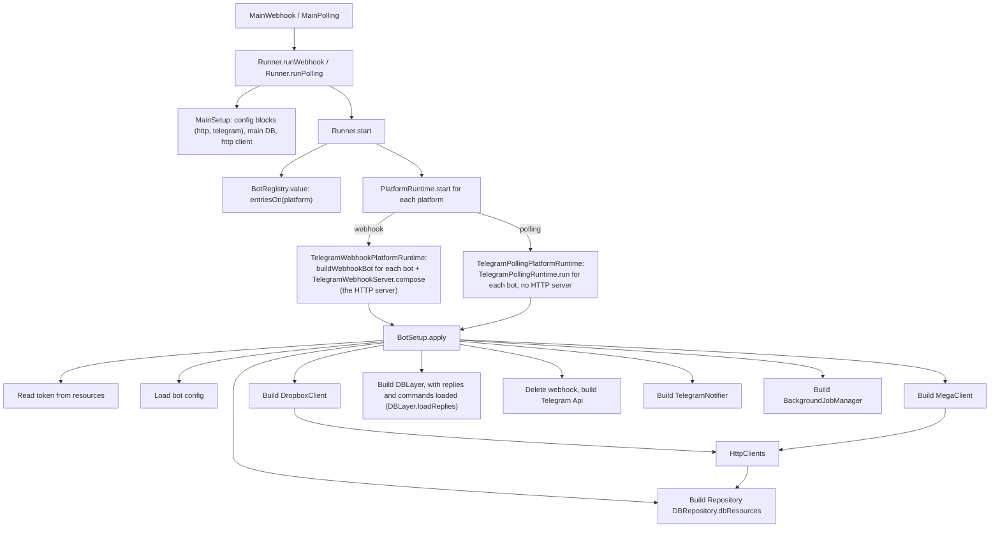
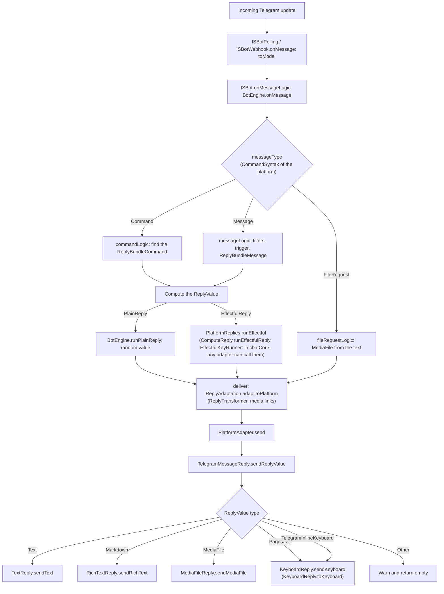
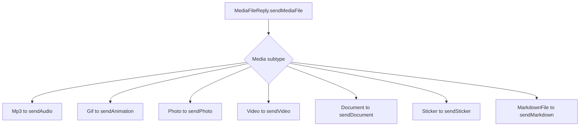
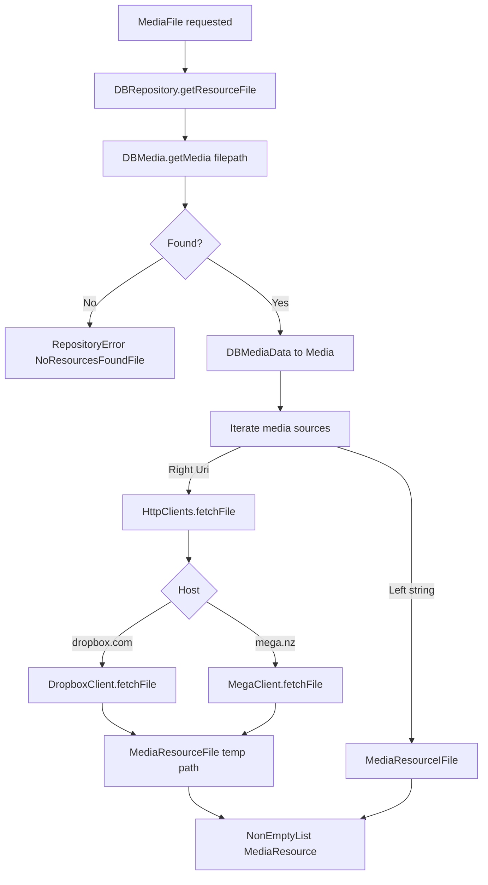
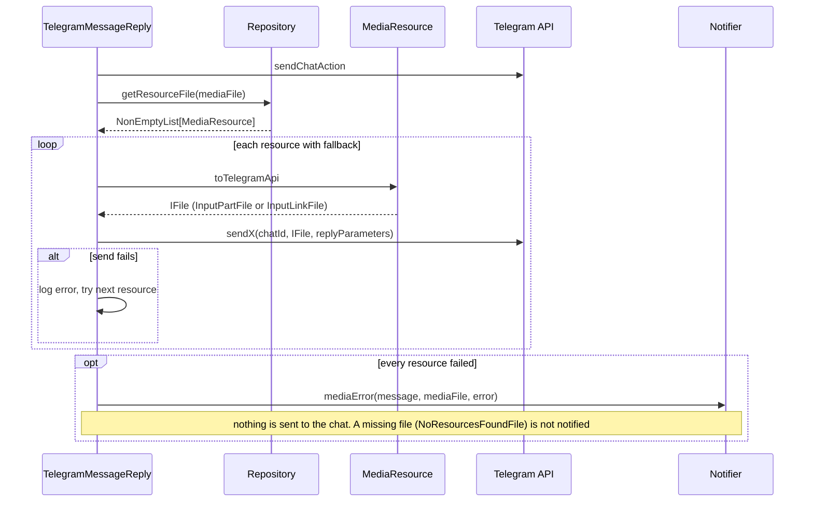
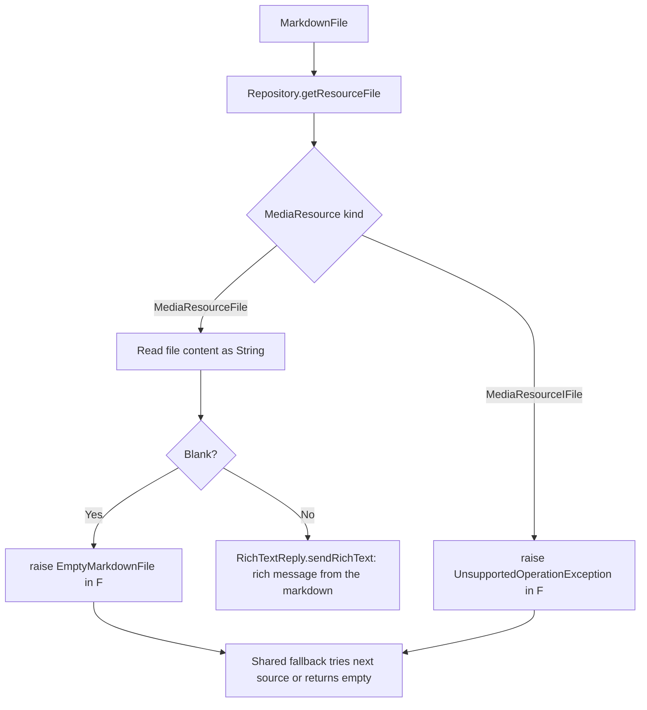

# Bot Logic Overview

This document gives a high-level map of how bots work in this repository, from startup to sending replies.

The bots are meant to run on several platforms (Telegram today; IRC, Discord and Slack are planned). The logic is platform
agnostic and lives in `chatCore`; what is specific to a platform lives in its adapter module (`chatTelegramAdapter` is the
only one so far) and in a *platform runtime* in `main`. Section 3 draws that line; the other sections follow the runtime path
that is most useful while implementing new behaviors (like markdown files).

## 1) Startup and Wiring

`MainWebhook` and `MainPolling` are thin entry points over the `Runner`. The `Runner` starts the *platform runtimes* for the
bots of `BotRegistry`, in one `Resource`. Every bot of the registry runs on the platforms of its entry (`platforms`, Telegram
by default); a bot bound to a platform that has no runtime fails the startup with the name of the bot and of the platform.
A runtime whose platform has no bots is not started (no Telegram webhook server when no bot runs on Telegram).

Which runtimes run depends on the mode, only for Telegram, the one platform that has a choice (webhook or polling). The
platforms that keep their own connection open (IRC, Discord, Slack) have no such choice: their runtimes run in every mode
and are registered in one place, `Runner.connectionRuntimes` (none yet).

### What matters here

- `BotRegistry` selects which bots are active and on which platforms; `MainPolling` can be given bot ids or names to run
  only those (`MainPolling rphjb XahLeeBot`).
- The configuration of `main` is in blocks: `http` (the HTTP server, only needed by the webhook), one per platform
  (`telegram`: webhook, certificate, the chat that gets the notifications of the operators), `main-db`,
  `healthcheck-ping`.
- `BotSetup` (Telegram) wires every dependency used by reply execution. The replies and the commands of the bot are loaded
  once, from its JSON files, and served from memory by the `DBLayer`.
- `HttpClients` is a dispatcher, not a downloader itself; it chooses Mega vs Dropbox client.

## 2) Incoming Message -> Reply Dispatch

A Telegram update becomes a platform agnostic `Message` (with a `ChatId(platform, id)`) and goes through the `BotEngine`.
The engine decides what to reply and hands the reply to the platform; it only knows the platform through the
`PlatformAdapter`.

After the reply the engine runs its post computation (the last interaction of the chat is logged, for the timeout). The
presses of the inline keyboards (pagination, a media, a show) are Telegram only: `ISBot.onCallbackLogic` handles them,
outside of the engine.

### Media subtype dispatch

## 3) Platform Agnostic vs Platform Specific

| Where | What |
|---|---|
| `chatCore` | `Platform`, `ChatId(platform, id)`, `Message` (its `messageId` is an optional `MessageId`, a string: Telegram numbers, Slack timestamps, nothing where there is no message, e.g. what a subscription sends); `PlatformCapabilities` (media kinds, text limit, markdown support, delete/edit/buttons, whether it accepts the media sources that are not an url, `CommandSyntax`); `BotEngine`; `PlatformAdapter` / `PlatformReplies`; `ReplyTransformer` and `ReplyAdaptation`; `PagedList`; `CronBackgroundJobManager` (the subscriptions of the bot on the platform of the manager); `Notifier`; the commands (`CommandPatterns`) and `EffectfulKeyRunner` / `ComputeReply`, which compute the commands that need the database |
| `chatTelegramAdapter` | `ISBot` (the Telegram shell around the engine), `ISBotPolling` / `ISBotWebhook`, `TelegramPlatformAdapter`, `TelegramCapabilities`, `TelegramNotifier`, `TelegramBackgroundJobManager`, `BotSetup`, the send chain (`TelegramMessageReply`, `MediaFileReply`, ...), the callbacks of the keyboards |
| `main` | `BotRegistry` / `BotRegistryEntry.platforms`, the config blocks, `Runner`, `PlatformRuntime` and the Telegram runtimes |

What a platform tells the engine is its `PlatformCapabilities`, and the `ReplyTransformer` adapts every reply to it before it
is sent (the same goes for what the subscriptions fire):

- a text or markdown over `maxTextLength` is split, preferably on a line break, then on a space
- markdown becomes plain text when the platform has no markdown (`MarkdownSupport.Plain`)
- the time to live of a text is dropped when the platform cannot delete messages
- a media the platform cannot send becomes its link as a text (`ReplyAdaptation` looks the link up in the DB), or it is
  dropped when it has none
- a `PagedList` (the result of a search or of the top twenty) becomes a numbered text of the current page when the platform
  has no buttons; a platform with buttons gets it as it is (Telegram maps it to its inline keyboard)
- the values only the platform knows (e.g. `TelegramInlineKeyboard`) pass through untouched

`CommandSyntax` is how a platform writes the commands: the prefix (`/` on Telegram), the optional mention of the bot
(`/command@BotName`), and a marker for the file requests (none on Telegram, they start with the bot id).

Telegram's capabilities send every kind of media and have markdown and buttons, so for Telegram the transformation changes
nothing but the texts over the Telegram limit.

### Media sources per platform

A platform adapter reads the media through `repository.usableFor(capabilities)`: when `acceptsFileIds` is off the file
references (`MediaResourceIFile`, the sources that are not an url) are left out, and a media with nothing usable is a not
found error. Every new adapter has to do the same, as `TelegramPlatformAdapter` does.

### Discord gateway

`chatDiscordAdapter` keeps the connection of a bot to the Discord gateway in `DiscordGateway`: `managed` opens it when the
resource is acquired and closes it on release (shutdown, wait for `main.discord.shutdown-timeout`, then close without
waiting), also when it never gets ready. JDA does the reconnects and the resume by itself, they are only logged. The token
of a bot is a document named `<botId>_<botName>_discord.token`, read with `DiscordToken.read`. The privileged message
content intent is `main.discord.message-content` (on by default: enable it in the developer portal too, or the connection is refused).

### Discord replies

`DiscordPlatformAdapter` sends through `DiscordReplies`, written against the small `DiscordApi` (`JdaDiscordApi` is the JDA
one, found through `JdaGatewayClient.jda` once the gateway is up). Texts and markdown are sent as they are (the engine
already split them to 2000 characters and Discord reads the backslash escapes), a text with a time to live is deleted
after it. A media is read from its url sources in order until one works and uploaded; above 10 MiB (`DiscordLimits`) it is
sent as its link. A markdown file is sent as text. A failure is logged and notified like on Telegram.

### Running a bot on Discord

`DiscordPlatformRuntime` (registered in `Runner.connectionRuntimes`, so it runs in every mode, and only when a bot of the
registry has `Platform.Discord` in its `platforms`) starts `DiscordBot.run` for each of them: the engine, the adapter, the
subscriptions (`CronBackgroundJobManager`, sending once the gateway is up) and the gateway connection, which registers the
slash commands of the bot once connected (`DiscordSlashCommands`: one per command with instructions, with the free text
option `arguments`; global commands can take up to an hour to show). To put a bot on Discord:
1. create its application in the Discord developer portal (discord.com/developers/applications), *Bot* tab: reset the
   token and add it as the document `<botId>_<botName>_discord.token` (like the Telegram one);
2. invite the bot to a server with the OAuth2 URL generator: scopes `bot` and `applications.commands`, permissions *View
   Channels*, *Send Messages*, *Read Message History*, *Attach Files* and *Manage Messages* (only to delete the messages
   with a time to live);
3. add `Platform.Discord` to the `platforms` of its `BotRegistryEntry`.

The commands are slash commands (they are interactions, no intent is needed to read them). The privileged *Message Content
Intent* is for the other messages, the ones the bot answers as on Telegram and the file requests: it is on by default
(`main.discord.message-content`, env `DISCORD_MESSAGE_CONTENT`), so enable it in the portal or set it to false, or the
connection is refused.

The chats of the bot are stored with `platform = discord`. The notifications of the operators go to the log on Discord.

### IRC connection

`chatIrcAdapter` keeps the connection of a bot to the IRC server in `IrcConnection` (`main.irc`: host, port, TLS, channels,
timeouts): `managed` opens it when the resource is acquired, waits for the registration (`irc.ready-timeout`, a wrong host
is retried by the library, so it would never fail by itself) and quits on release. When the connection is lost Kitteh
reconnects after a delay that doubles up to `reconnect-max-delay` and starts again once the bot is registered, and the
channels are joined at every registration. The nick of a bot is its name (`IrcCredentials.nick`); with the document
`<botId>_<botName>_irc.token` the bot identifies with SASL PLAIN as that nick, without it it connects unidentified.

### IRC inbound

`IrcInbound` maps a channel or private message to the engine `Message`: the chat is the channel, or the sender for a private
message (nicks and channels are case insensitive, so the ids are lowercase), there is no message id, the formatting codes
(colors, bold, ...) are removed, and the messages of the bot itself are ignored. `IrcInboundListener` hands them to the
engine, dropping the ones of a sender over `main.irc.rate-limit-messages` per `rate-limit-window` (`RateLimiter`, a fixed
window per sender). It should get a parallel dispatcher: the messages of a chat are then not handled in order.

### IRC outbound

`IrcPlatformAdapter` sends through `IrcReplies`, written against the small `IrcApi` (`KittehIrcApi` is the Kitteh one, from
`KittehConnection.client`). The engine has already made the reply plain: the markdown is plain text, a media is its link, the
time to live is gone. `IrcLines` cuts a text in the lines IRC carries: one message per line (a line break or control
character in a message would be taken as a command by the server, so they are removed), at most 400 characters and 400 bytes
a line (multibyte text is longer in bytes), at most 20 lines a reply (the rest is replaced by a line that says how many were
left out). The flood control is the queue of Kitteh: one message every `main.irc.message-delay` (1.2 seconds). The text goes to
the channel, or to the nick for a private message; IRC has no reply to a message.

### Running a bot on IRC

`IrcPlatformRuntime` (registered in `Runner.connectionRuntimes` after the Discord one, and only started when a bot of the
registry has `Platform.Irc` in its `platforms`) starts `IrcBot.run` for each of them: the engine, the adapter, the
subscriptions (`CronBackgroundJobManager`, sending once the connection is up) and the connection, one per bot with its name
as the nick. A bot that fails there (no connection within `irc.ready-timeout`, ...) is logged and stops, the other bots keep
running. To put a bot on IRC:
1. set `main.irc` (host, port, TLS, and `channels`: the ones every bot joins; without channels the bot only answers private
   messages), by `application.conf` or `IRC_HOST`, `IRC_PORT`, `IRC_TLS`;
2. if its nick is registered with NickServ, add the password as the document `<botId>_<botName>_irc.token` (SASL PLAIN, the
   nick is the account); without it the bot connects unidentified;
3. add `Platform.Irc` to the `platforms` of its `BotRegistryEntry`.

The commands are written `!command`, a trigger is any message of the channel. The paged lists are numbered texts, the media
are their links. The chats are stored with `platform = irc`, the id being the lowercase channel or nick.

### IRC: configuration and limitations

`main.irc` (`application.conf`; the env var overrides are `IRC_HOST`, `IRC_PORT` and `IRC_TLS`):

| key | default | what |
|---|---|---|
| `host`, `port`, `tls` | `irc.libera.chat`, 6697, true | the server, the port must be the TLS one when `tls` is true |
| `channels` | none | joined by every bot at every registration; a list, no env override |
| `ready-timeout` | 60 s | how long a bot is given to connect and register |
| `shutdown-timeout` | 10 s | how long the connection is given to close after the quit |
| `reconnect-base-delay`, `reconnect-max-delay` | 2 s, 60 s | the delay before a reconnection, doubled at every failed attempt |
| `message-delay` | 1200 ms | between two messages a bot sends (flood protection of the server) |
| `rate-limit-messages`, `rate-limit-window` | 5, 10 s | the messages of one sender a bot handles, the next ones are ignored |

Limitations:
- Text only: a media is sent as its link, the markdown as plain text, there are no buttons; a paged list is a numbered text
  and there is no way to ask for another page.
- A reply is at most 20 lines of 400 characters and bytes, one message every 1.2 seconds, so a long text is slow and the rest
  is cut. IRC has no reply to a message, no message ids, no deleting (the time to live is ignored) and no editing.
- The messages of a chat are not handled in order, and the ones over the rate limit are dropped (logged).
- Only the configured channels are joined, the same for every bot, and a bot that is kicked is not sent back.
- The help texts of the commands still write `/command`: on IRC it is `!command`.
- Tested against a fake server with the real library (registration, SASL PLAIN, join, reconnection, messages), not against
  a real network, and TLS is not covered by the tests.

### Known gaps

- The sources that are not an url are plain strings in the DB and do not say which platform they belong to: today they are
  all Telegram's file references. A platform that declares it accepts them would be handed Telegram's, so before a second
  platform keeps its own, they have to be tagged with the platform they belong to (and the capability, a plain
  `acceptsFileIds`, would become "accepts the ones of its platform"). Discord and Slack start with it off and the filter
  applied; tagging the references, converting the data and the DB, and letting them reuse their own uploads is the milestone
  "M4 - Platform-tagged file references" (epic #1387).
- A platform without buttons shows only the requested page of a `PagedList`: there is no page argument yet.
- The help texts of the commands write `/command`, whatever the syntax of the platform.

## 4) How Media Is Resolved From DB Sources

The repository resolves each media file to one or more candidate sources. Sources can be either:

- `Right(Uri)` -> remote URL (Mega/Dropbox), fetched to temp file
- `Left(String)` -> Telegram reusable file reference (mapped to `MediaResourceIFile`)

## 5) Sending Media: Fallback Behavior

For non-text media sends, the Telegram adapter uses a shared pattern (`telegramFileReplyPattern`):

### Why fallback exists

- A media item can have multiple sources.
- If first source fails (expired link, transient network issue), next source is attempted.
- If all of them fail the `Notifier` tells the operators (`TelegramNotifier`: a Telegram chat, `main.telegram.ops-chat-id`).

## 6) Markdown Current Behavior

Markdown enters the same `MediaFile` branch and is handled by `sendMarkdown`. The same `Markdown` reply value (not a file) is
sent by `sendReplyValue` as a rich message too.

- `MediaResourceFile` is read as text and sent with `RichTextReply.sendRichText`, as a rich message made of the markdown.
  A file with no content (blank) is an error (`EmptyMarkdownFile`), handled as a failed source.
- `MediaResourceIFile` is explicitly unsupported and raises an `UnsupportedOperationException` in `F`; this is then handled
  by the shared reply pipeline as a failed source.

A platform without markdown gets a `Markdown` reply value as plain text (formatting removed, links as `text (url)`), see
section 3. A `MarkdownFile` is a media kind of its own (`MediaKind.MarkdownFile`): a platform that does not list it gets its
link.

## 7) Practical Mental Model

- `ReplyValue` decides *what* to send.
- `BotEngine` decides *what to reply* to a message, whatever the platform.
- `PlatformCapabilities` and the `ReplyTransformer` decide *what the platform can receive* and adapt the reply to it.
- `Repository` decides *where content comes from*.
- `MediaResource` decides *how Telegram receives it* (`InputPartFile` vs `InputLinkFile`).
- `TelegramMessageReply` decides *how to execute and fallback*.

If you keep these responsibilities separate, adding new media behavior, or a new platform, is much easier and safer.
