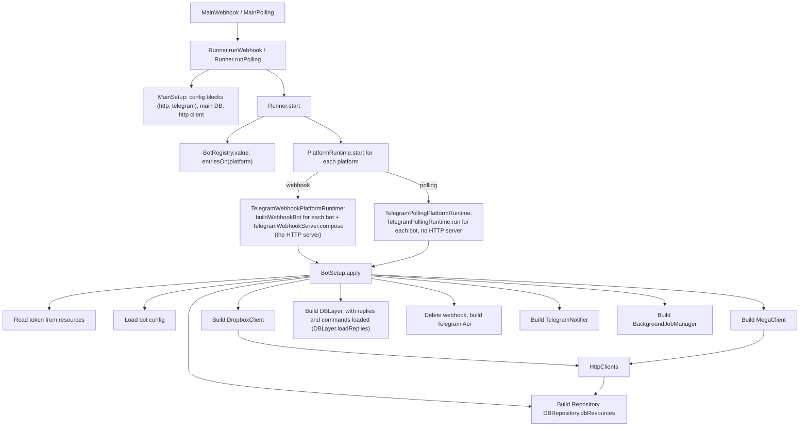
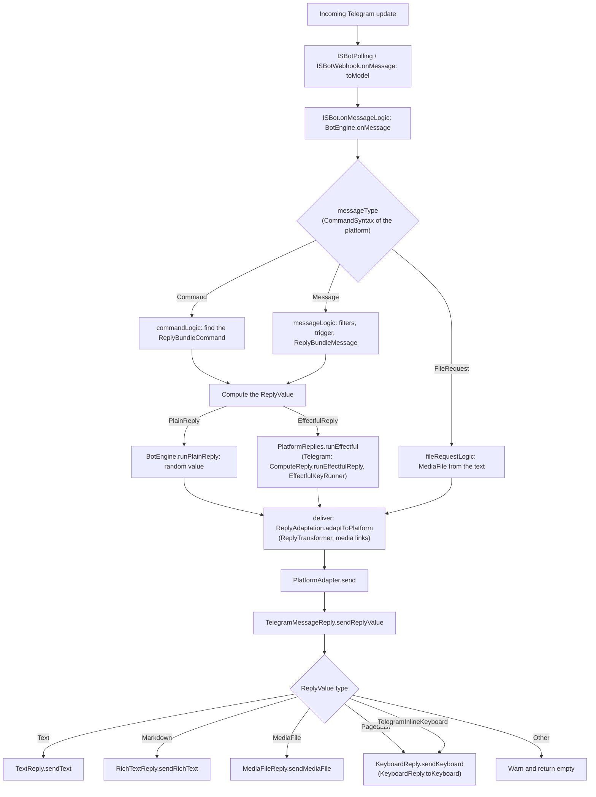
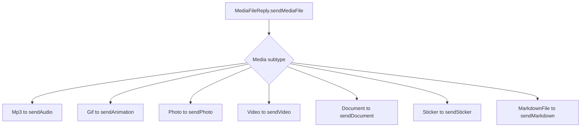
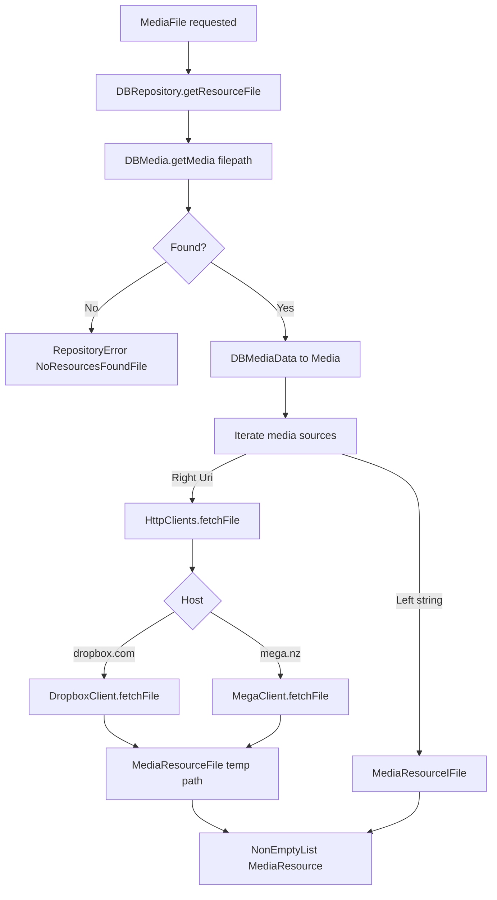
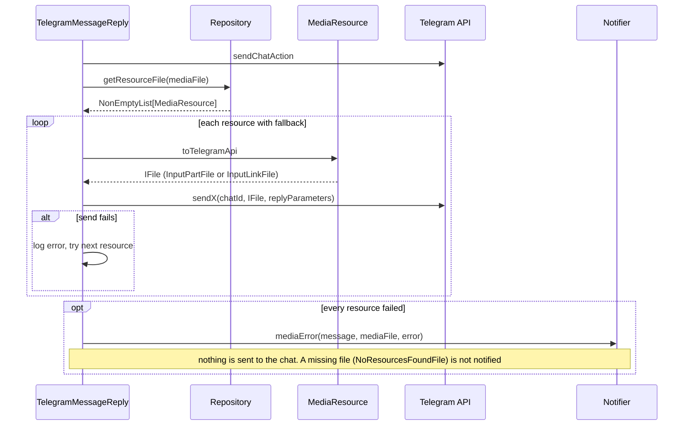
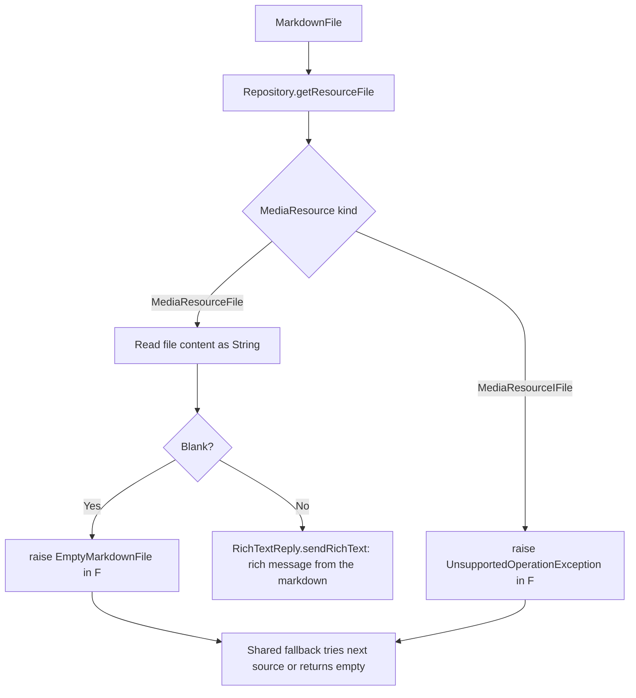

# Bot Logic Overview

This document gives a high-level map of how bots work in this repository, from startup to sending replies.

The bots are meant to run on several platforms (Telegram today; IRC, Discord and Slack are planned). The logic is platform
agnostic and lives in `chatCore`; what is specific to a platform lives in its adapter module (`chatTelegramAdapter` is the
only one so far) and in a *platform runtime* in `main`. Section 3 draws that line; the other sections follow the runtime path
that is most useful while implementing new behaviors (like markdown files).

## 1) Startup and Wiring

`MainWebhook` and `MainPolling` are thin entry points over the `Runner`. The `Runner` starts the *platform runtimes* for the
bots of `BotRegistry`, in one `Resource`. Every bot of the registry runs on the platforms of its entry (`platforms`, Telegram
by default); a bot bound to a platform that has no runtime fails the startup with the name of the bot and of the platform.

### What matters here

- `BotRegistry` selects which bots are active and on which platforms; `MainPolling` can be given bot ids or names to run
  only those (`MainPolling rphjb XahLeeBot`).
- The configuration of `main` is in blocks: `http` (the HTTP server, only needed by the webhook), one per platform
  (`telegram`: webhook, certificate, the chat that gets the notifications of the operators), `main-db`,
  `healthcheck-ping`.
- `BotSetup` (Telegram) wires every dependency used by reply execution. The replies and the commands of the bot are loaded
  once, from its JSON files, and served from memory by the `DBLayer`.
- `HttpClients` is a dispatcher, not a downloader itself; it chooses Mega vs Dropbox client.

## 2) Incoming Message -> Reply Dispatch

A Telegram update becomes a platform agnostic `Message` (with a `ChatId(platform, id)`) and goes through the `BotEngine`.
The engine decides what to reply and hands the reply to the platform; it only knows the platform through the
`PlatformAdapter`.

After the reply the engine runs its post computation (the last interaction of the chat is logged, for the timeout). The
presses of the inline keyboards (pagination, a media, a show) are Telegram only: `ISBot.onCallbackLogic` handles them,
outside of the engine.

### Media subtype dispatch

## 3) Platform Agnostic vs Platform Specific

| Where | What |
|---|---|
| `chatCore` | `Platform`, `ChatId(platform, id)`, `Message`; `PlatformCapabilities` (media kinds, text limit, markdown support, delete/edit/buttons, file ids, `CommandSyntax`); `BotEngine`; `PlatformAdapter` / `PlatformReplies`; `ReplyTransformer` and `ReplyAdaptation`; `PagedList`; `CronBackgroundJobManager` (the subscriptions); `Notifier`; the commands (`CommandPatterns`) |
| `chatTelegramAdapter` | `ISBot` (the Telegram shell around the engine), `ISBotPolling` / `ISBotWebhook`, `TelegramPlatformAdapter`, `TelegramCapabilities`, `TelegramNotifier`, `TelegramBackgroundJobManager`, `BotSetup`, the send chain (`TelegramMessageReply`, `MediaFileReply`, ...), the callbacks of the keyboards, `EffectfulKeyRunner` |
| `main` | `BotRegistry` / `BotRegistryEntry.platforms`, the config blocks, `Runner`, `PlatformRuntime` and the Telegram runtimes |

What a platform tells the engine is its `PlatformCapabilities`, and the `ReplyTransformer` adapts every reply to it before it
is sent (the same goes for what the subscriptions fire):

- a text or markdown over `maxTextLength` is split, preferably on a line break, then on a space
- markdown becomes plain text when the platform has no markdown (`MarkdownSupport.Plain`)
- the time to live of a text is dropped when the platform cannot delete messages
- a media the platform cannot send becomes its link as a text (`ReplyAdaptation` looks the link up in the DB), or it is
  dropped when it has none
- a `PagedList` (the result of a search or of the top twenty) becomes a numbered text of the current page when the platform
  has no buttons; a platform with buttons gets it as it is (Telegram maps it to its inline keyboard)
- the values only the platform knows (e.g. `TelegramInlineKeyboard`) pass through untouched

`CommandSyntax` is how a platform writes the commands: the prefix (`/` on Telegram), the optional mention of the bot
(`/command@BotName`), and a marker for the file requests (none on Telegram, they start with the bot id).

Telegram's capabilities send every kind of media and have markdown and buttons, so for Telegram the transformation changes
nothing but the texts over the Telegram limit.

### Known gaps

- `ReplyTransformer.usableSources` (drop the sources that are Telegram file ids, `Left`, on the platforms that do not accept
  them) is there and tested, but nothing applies it yet: the repository tries every source.
- `EffectfulKeyRunner`, which computes the commands that need the database (search, subscribe, timeout, ...), lives in
  `chatTelegramAdapter`, although it only uses `chatCore` types: another adapter would need it moved to `chatCore`.
- A platform without buttons shows only the requested page of a `PagedList`: there is no page argument yet.
- The help texts of the commands write `/command`, whatever the syntax of the platform.

## 4) How Media Is Resolved From DB Sources

The repository resolves each media file to one or more candidate sources. Sources can be either:

- `Right(Uri)` -> remote URL (Mega/Dropbox), fetched to temp file
- `Left(String)` -> Telegram reusable file reference (mapped to `MediaResourceIFile`)

## 5) Sending Media: Fallback Behavior

For non-text media sends, the Telegram adapter uses a shared pattern (`telegramFileReplyPattern`):

### Why fallback exists

- A media item can have multiple sources.
- If first source fails (expired link, transient network issue), next source is attempted.
- If all of them fail the `Notifier` tells the operators (`TelegramNotifier`: a Telegram chat, `main.telegram.ops-chat-id`).

## 6) Markdown Current Behavior

Markdown enters the same `MediaFile` branch and is handled by `sendMarkdown`. The same `Markdown` reply value (not a file) is
sent by `sendReplyValue` as a rich message too.

- `MediaResourceFile` is read as text and sent with `RichTextReply.sendRichText`, as a rich message made of the markdown.
  A file with no content (blank) is an error (`EmptyMarkdownFile`), handled as a failed source.
- `MediaResourceIFile` is explicitly unsupported and raises an `UnsupportedOperationException` in `F`; this is then handled
  by the shared reply pipeline as a failed source.

A platform without markdown gets a `Markdown` reply value as plain text (formatting removed, links as `text (url)`), see
section 3. A `MarkdownFile` is a media kind of its own (`MediaKind.MarkdownFile`): a platform that does not list it gets its
link.

## 7) Practical Mental Model

- `ReplyValue` decides *what* to send.
- `BotEngine` decides *what to reply* to a message, whatever the platform.
- `PlatformCapabilities` and the `ReplyTransformer` decide *what the platform can receive* and adapt the reply to it.
- `Repository` decides *where content comes from*.
- `MediaResource` decides *how Telegram receives it* (`InputPartFile` vs `InputLinkFile`).
- `TelegramMessageReply` decides *how to execute and fallback*.

If you keep these responsibilities separate, adding new media behavior, or a new platform, is much easier and safer.
