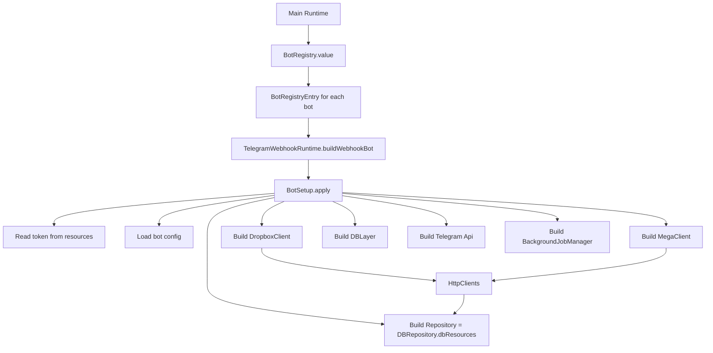
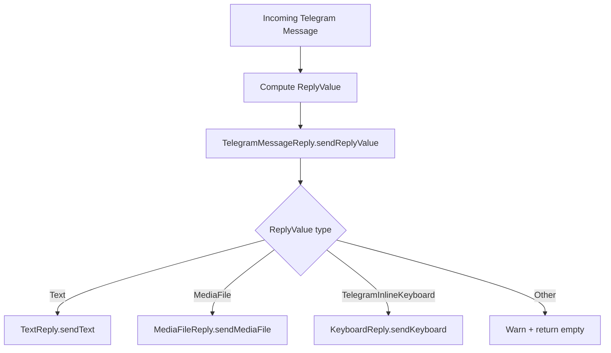
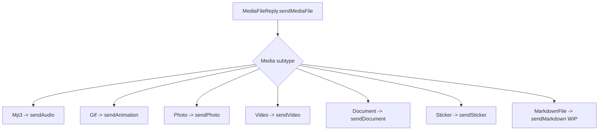
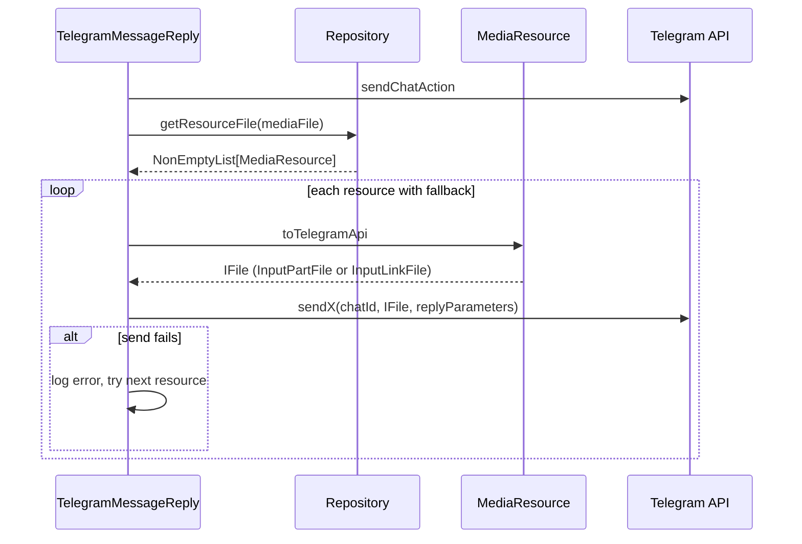
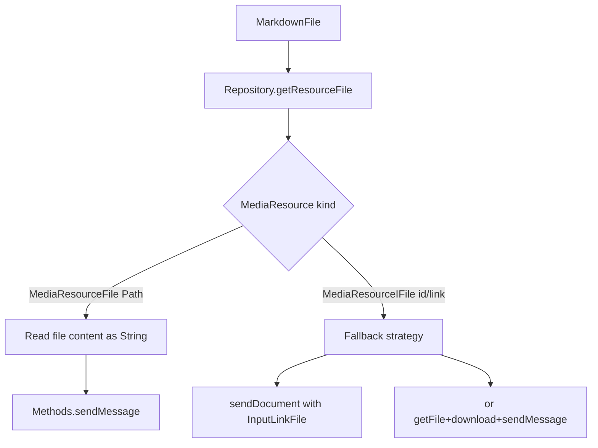

# Bot Logic Overview

This document gives a high-level map of how bots work in this repository, from startup to sending replies.

It is intentionally focused on the runtime path that is most useful while implementing new media behaviors (like markdown files).

## 1) Startup and Wiring

At startup, the app builds one runtime per bot from `BotRegistry`, then each runtime builds its own `BotSetup`.



### What matters here

- `BotRegistry` selects which bots are active.
- `BotSetup` wires every dependency used by reply execution.
- `HttpClients` is a dispatcher, not a downloader itself; it chooses Mega vs Dropbox client.

## 2) Incoming Message -> Reply Dispatch

Once a message is parsed into your internal model, reply sending is dispatched by reply type.



### Media subtype dispatch



## 3) How Media Is Resolved From DB Sources

The repository resolves each media file to one or more candidate sources. Sources can be either:

- `Right(Uri)` -> remote URL (Mega/Dropbox), fetched to temp file
- `Left(String)` -> Telegram reusable file reference (mapped to `MediaResourceIFile`)

```mermaid
flowchart TD
  A[MediaFile requested] --> B[DBRepository.getResourceFile]
  B --> C[DBMedia.getMedia(filepath)]
  C --> D{Found?}
  D -->|No| E[RepositoryError.NoResourcesFoundFile]
  D -->|Yes| F[DBMediaData -> Media]
  F --> G[Iterate mediaSources]

  G -->|Right Uri| H[HttpClients.fetchFile]
  H --> I{Host}
  I -->|dropbox.com| J[DropboxClient.fetchFile]
  I -->|mega.nz| K[MegaClient.fetchFile]
  J --> L[MediaResourceFile temp path]
  K --> L

  G -->|Left string| M[MediaResourceIFile]

  L --> N[NonEmptyList MediaResource]
  M --> N
```

## 4) Sending Media: Fallback Behavior

For non-text media sends, the adapter uses a shared pattern (`telegramFileReplyPattern`):



### Why fallback exists

- A media item can have multiple sources.
- If first source fails (expired link, transient network issue), next source is attempted.

## 5) Markdown WIP Positioning

Markdown currently enters the same `MediaFile` branch but requires a different final step:

- `MediaResourceFile` can be read as text and sent with `sendMessage`.
- `MediaResourceIFile` is not text by itself; it is a reference usable as file input.



## 6) Practical Mental Model

- `ReplyValue` decides *what* to send.
- `Repository` decides *where content comes from*.
- `MediaResource` decides *how Telegram receives it* (`InputPartFile` vs `InputLinkFile`).
- `TelegramMessageReply` decides *how to execute and fallback*.

If you keep these four responsibilities separate, adding new media behavior is much easier and safer.
